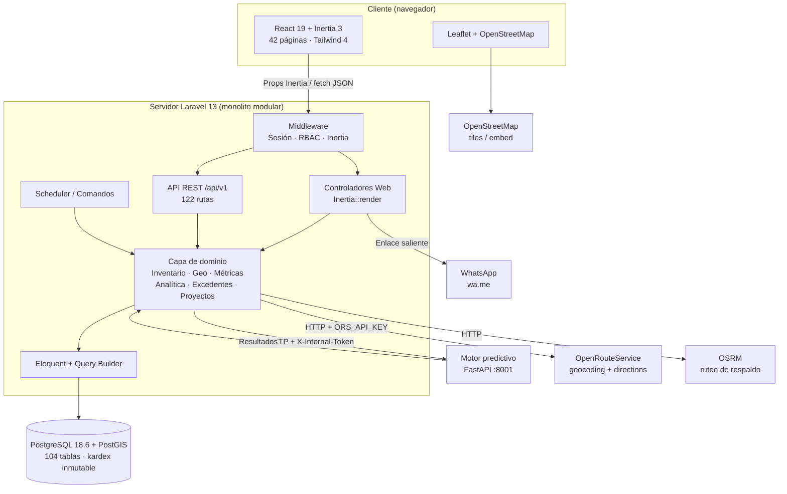
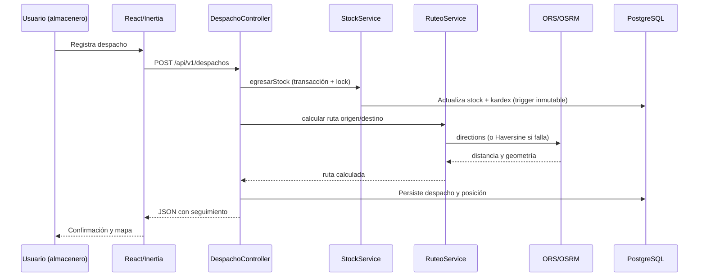

# Actividad 1. Documentación de la arquitectura de software

**Proyecto:** Consorcio Pillco Marca — ObraFlow
**Repositorio:** https://github.com/OverBM/Consorcio_Pillco_Marca
**Fecha de verificación:** 10/11/2026

---

## 1.1. Identificación de la arquitectura

### Tipo de arquitectura

ObraFlow es un **monolito modular** con **renderizado del lado del servidor y
hidratación de una SPA** mediante Laravel + Inertia.js + React. No es una
arquitectura de microservicios: la aplicación web, la API y los procesos de
negocio se ejecutan en un único despliegue Laravel. El único servicio separado
es el **motor predictivo en Python (FastAPI)**, que funciona como servicio
satélite interno y no como núcleo del sistema.

| Característica | Implementación verificada |
|---|---|
| Estilo principal | Monolito modular (Laravel 13.17) |
| Presentación | React 19 + Inertia.js 3 + Tailwind CSS 4 |
| API | REST versionada en `/api/v1` (122 rutas expuestas) |
| Persistencia | PostgreSQL 18.6 + PostGIS (104 tablas) |
| Servicio satélite | FastAPI/uvicorn en `127.0.0.1:8001` |
| Comunicación cliente-servidor | Props Inertia en navegación; JSON en la API |
| Autenticación | Sesión web + token Bearer (`remember_token`) para API |

### Capas y componentes principales

```text
┌──────────────────────────────────────────────────────────────────────┐
│ 1. Presentación       resources/js (React 19, Inertia, Tailwind 4)   │
│    - 42 páginas, design system, navegación por permisos              │
├──────────────────────────────────────────────────────────────────────┤
│ 2. Transporte         routes/web.php, routes/api.php, middleware     │
│    - HandleInertiaRequests, EnsureModuleAccess, ResolveApiUser       │
├──────────────────────────────────────────────────────────────────────┤
│ 3. Aplicación         app/Http/Controllers/Web y /Api/V1             │
│    - Controladores delgados; validación y autorización               │
├──────────────────────────────────────────────────────────────────────┤
│ 4. Dominio            app/Domain (Inventario, Geo, Métricas,         │
│                       Analítica, Excedentes, Proyectos, Personal)     │
│    - Reglas de negocio, transacciones, cálculo de indicadores        │
├──────────────────────────────────────────────────────────────────────┤
│ 5. Persistencia       Eloquent + Query Builder + migraciones         │
│    - PostgreSQL 18.6/PostGIS; 25 migraciones; 104 tablas             │
├──────────────────────────────────────────────────────────────────────┤
│ 6. Integración        Http client, ORS/OSRM/OSM, FastAPI, WhatsApp   │
└──────────────────────────────────────────────────────────────────────┘
```

### Módulos funcionales y responsabilidades

| Módulo | Rutas principales | Responsabilidad |
|---|---|---|
| Acceso y seguridad | `/login`, `/registro`, `/admin/usuarios`, `/admin/solicitudes` | Autenticación por sesión, RBAC por rol/permiso, solicitudes de alta y auditoría |
| Panel general | `/panel` | Consolidado de inventario, nivel de servicio, PMI y analítica |
| Logística e inventario | `/stock`, `/recepcion`, `/solicitudes`, `/despachos`, `/transferencias`, `/inventario-fisico`, `/mermas` | Stock multi-almacén, kardex inmutable, reservas, despachos y mermas |
| Compras y abastecimiento | `/compras/*`, proveedores, cotizaciones, órdenes, devoluciones | Requerimientos, comparativo de cotizaciones y órdenes de compra |
| Proyectos y PMI | `/programa`, `/gestion-obra/*` | Partidas, cronograma/EVM, riesgos, cambios, cierre y liquidación |
| Personal y SST | `/personal/*`, `/sst/*` | Asistencia con geocerca, planillas, capacitaciones, EPP e incidentes |
| Calidad y ambiente | `/calidad/observaciones`, `/ambiente/*` | Observaciones técnicas, monitoreo ambiental y residuos |
| Geolocalización | `/mapa-operativo`, `/api/v1/geo/*` | Geocodificación, rutas, geocercas y tracking de despachos |
| Analítica predictiva | `/analitica`, `/api/v1/analitica/*` | Pronóstico de demanda, EOQ, alertas y redistribución |
| Reportes | `/reportes` | Indicadores de negocio con filtros y exportación CSV |
| Administración | `/admin/*` | Usuarios, parámetros, fases, auditoría y solicitudes de acceso |

### Comunicación entre componentes

1. **Navegación web (Inertia):** el controlador devuelve `Inertia::render()` con
   props; React recibe los datos sin una llamada API adicional. Los props
   diferidos (`Inertia::defer`) cargan métricas pesadas después del primer
   render.
2. **Operaciones asíncronas del cliente:** las páginas consumen `/api/v1` con
   `fetch` y `credentials: 'same-origin'`; la sesión web identifica al usuario.
3. **API para consumidores externos:** `ResolveApiUser` acepta un token Bearer
   almacenado en `remember_token` y lo resuelve contra el guard `web`.
4. **Servicio de analítica:** Laravel llama a `http://127.0.0.1:8001/v1/pipeline`
   con el encabezado `X-Internal-Token`; el resultado se persiste en PostgreSQL.
5. **Procesos programados:** el scheduler ejecuta `analitica:ejecutar`; la cola
   está configurada en modo `sync` para el entorno local.

### Gestión e interacción con la base de datos

- Motor: **PostgreSQL 18.6** con extensión **PostGIS** (`geography(Point,4326)`
  en obras, almacenes, recepciones, solicitudes y marcaciones).
- 25 migraciones versionadas y **104 tablas** en la base `consorcio_pillcomarca`.
- `StockService` es el único punto de mutación del stock: usa
  `DB::transaction()` + `lockForUpdate()` para ingresos, egresos y reservas.
- Trigger `trg_kardex_inmutable` impide `UPDATE`/`DELETE` sobre `kardex`; los
  ajustes se registran como movimientos compensatorios.
- Reportes y panel usan el Query Builder con filtros por obra, almacén,
  categoría y fechas; no hay datos estáticos en la vista.

### Integración con servicios externos

| API o servicio | Funcionalidad | Información intercambiada | Justificación |
|---|---|---|---|
| OpenRouteService (ORS) | Geocodificación directa/inversa y rutas | Dirección, coordenadas, distancia y geometría | Ubicar obras, almacenes y calcular rutas logísticas |
| OSRM | Ruteo alternativo | Coordenadas de origen/destino y ruta | Respaldo si ORS falla o agota presupuesto |
| OpenStreetMap | Mapa base y enlace público | Tiles y coordenadas (bbox/marcador) | Visualización sin costo de licencia |
| WhatsApp (`wa.me`) | Notificación saliente al proveedor | Teléfono y mensaje prellenado | Avisar sin contratar una API de mensajería |
| Motor analítico FastAPI | Pronóstico y alertas | Payload JSON de inventario/consumo | Cálculo estadístico fuera de PHP |

**Justificación de las ausencias:** no se integra una pasarela de pagos porque el
sistema gestiona abastecimiento e inventario, no cobros en línea. El correo usa
el driver `log` en desarrollo y no depende de un proveedor externo. Las
notificaciones internas se generan en la base de datos.

---

## 1.2. Diagrama de arquitectura de software



### Flujo de una operación típica (despacho con ruta)



### Evidencias de la arquitectura

| Evidencia | Ubicación / verificación |
|---|---|
| Estructura de capas | `app/Domain`, `app/Http/Controllers`, `resources/js` |
| Rutas web y API | `php artisan route:list --except-vendor` → 179 rutas, 122 de `/api/v1` |
| Módulos de dominio | `app/Domain/{Analitica,Excedentes,Geo,Inventario,Metricas,Optimization,Personal,Project,Proyectos}` |
| Base de datos | `php artisan db:show` → PostgreSQL 18.6, 104 tablas |
| PostGIS y kardex inmutable | `database/migrations/2026_10_04_000001_habilitar_extension_postgis.php` y `..._000004_crear_tablas_materiales_stock_kardex.php` |
| Transacciones de stock | `app/Domain/Inventario/StockService.php` (`DB::transaction`, `lockForUpdate`) |
| APIs externas | `config/ruteo.php`, `app/Domain/Geo/Drivers/*`, `.env` (`ORS_API_KEY`) |
| Integración analítica | `app/Domain/Analitica/AnaliticaClient.php`, `analytics/app/main.py` |
| Evidencia de ejecución | `docs/evidencias/reportes-actual.png`, `docs/evidencias/modo-oscuro-actual.png`, `docs/evidencias/buscador-superposicion.png` |

> **Nota de corrección:** el documento anterior `docs/01-arquitectura.md`
> describía un despliegue separado `frontend/web:4200` + `backend/api:3000` con
> TanStack Query y Axios. Esa estructura **no corresponde** a la aplicación
> ejecutable: solo existen Dockerfiles heredados del laboratorio DevOps en esas
> carpetas. La arquitectura vigente es el monolito Laravel + Inertia descrito en
> este documento.
