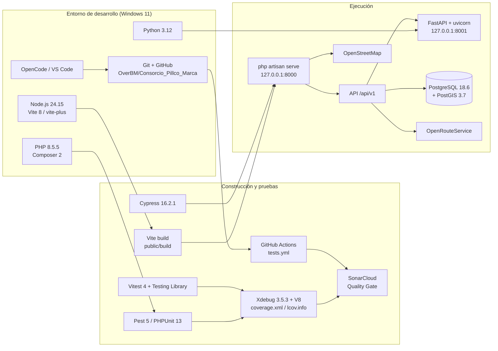

# Actividad 2. Documentación de la arquitectura tecnológica

**Proyecto:** Consorcio Pillco Marca — ObraFlow
**Fecha de verificación:** 10/11/2026

---

## 2.1. Identificación de las tecnologías

| Componente | Tecnología utilizada | Versión verificada | Propósito |
|---|---|---|---|
| Frontend | React + TypeScript | React 19.2 / TS 5.7.2 | Construcción de la interfaz de usuario (42 páginas) |
| Framework frontend | Inertia.js | `@inertiajs/react` 3.x | Comunicación SPA sin API manual, props del servidor |
| Estilos | Tailwind CSS | 4.1.11 | Design system, modo claro/oscuro y responsive |
| Backend | PHP | 8.5.5 (composer exige ^8.3) | Implementación de la lógica de negocio |
| Framework backend | Laravel | 13.30.1 | Estructuración, routing, ORM, seguridad y scheduler |
| Puente full-stack | Inertia Laravel | 3.3.3 | Renderizado de páginas y props diferidos |
| Tipado de rutas | Laravel Wayfinder | 0.1.14 | Funciones TypeScript generadas desde controladores |
| Base de datos | PostgreSQL + PostGIS | 18.6 / PostGIS 3.7 | Almacenamiento relacional y datos geográficos |
| Acceso a datos | Eloquent + Query Builder | Laravel 13 | Modelos, relaciones, transacciones y consultas |
| Servicio analítico | Python + FastAPI | Python 3.12 / FastAPI 0.115.6 | Pronóstico, EOQ y alertas |
| Servidor analítico | uvicorn | 0.34.0 | Exposición del motor en `127.0.0.1:8001` |
| Librerías analíticas | pandas / numpy / statsmodels | 2.2.3 / 2.2.1 / 0.14.4 | Series temporales y estadística |
| Entorno de desarrollo | OpenCode + VS Code compatible | — | Edición, agentes y ejecución de tareas |
| Runtime JS | Node.js | 24.15.0 (CI: 22) | Build, pruebas y tooling |
| Bundler | Vite / vite-plus | Vite 8 / vite-plus 0.3.0 | Compilación de assets y HMR |
| Control de versiones | Git + GitHub | — | Gestión de cambios y repositorio remoto |
| Servidor local | `php artisan serve` | Laravel 13 | Ejecución en `127.0.0.1:8000` |
| CI | GitHub Actions | `tests.yml` | Integración continua en push/PR a `main` |
| Automatización de pruebas | Cypress | 16.2.1 | Pruebas E2E sobre la aplicación real |
| Pruebas backend | Pest + PHPUnit | 5.1.4 / 13.3.2 | Pruebas de feature y unitarias |
| Pruebas frontend | Vitest + Testing Library | Vitest 4.1.11 | Pruebas de componentes y utilidades |
| Cobertura | Xdebug + V8 | Xdebug 3.5.3 / `@vitest/coverage-v8` | Reportes `coverage.xml` y `coverage/lcov.info` |
| Análisis de calidad | SonarCloud (SonarQube SaaS) | Scanner `@sonar/scan` | Evaluación estática, Quality Gate y métricas |
| Formato / lint | Pint + ESLint (vite-plus) | Pint 1.27 | Estilo consistente de PHP y TS |
| Tipado estático | Larastan / PHPStan | 3.9 | Análisis estático de PHP |

> **Sobre SonarQube:** la rúbrica menciona SonarQube. Se utiliza
> **SonarCloud**, el servicio en la nube del mismo motor SonarQube. El proyecto
> está registrado en `https://sonarcloud.io` con la key
> `consorcio-pillco-marca_version-2`; las reglas, métricas y Quality Gate son
> equivalentes.

### Justificación de las elecciones

- **Laravel + Inertia + React:** permite un monolito con SPA sin mantener dos
  despliegues ni una API adicional para cada pantalla; la API `/api/v1` queda
  disponible para integraciones y móvil.
- **PostgreSQL + PostGIS:** el negocio requiere geocercas, distancias y rutas;
  PostGIS evita calcular geometría en la aplicación.
- **Tailwind 4:** tokens y modo oscuro consistentes en 42 páginas.
- **Cypress:** valida flujos completos sobre la app real, incluida la sesión y
  los componentes renderizados.
- **SonarCloud:** no requiere operar un servidor SonarQube y publica el
  Quality Gate en cada análisis.
- **FastAPI:** el pronóstico con pandas/statsmodels es más expresivo que en PHP
  y se aísla del ciclo de request web.

---

## 2.2. Diagrama de arquitectura tecnológica



### Topología de ejecución local

```text
Navegador (http://127.0.0.1:8000)
        │  HTML + props Inertia / fetch JSON
        ▼
Laravel 13 (php artisan serve)
        ├── PostgreSQL 18.6 + PostGIS (127.0.0.1:5432)
        ├── FastAPI (127.0.0.1:8001)  ← analítica predictiva
        ├── OpenRouteService / OSRM   ← geocodificación y rutas
        └── OpenStreetMap             ← mapa base
```

---

## 2.3. Entorno de trabajo y despliegue

### 1. Entorno utilizado para desarrollar

- **Sistema operativo:** Windows 11 (x64).
- **Editor/agente:** OpenCode con reglas del proyecto (`AGENTS.md`,
  `opencode.json`, `.specsmd/`) y compatibilidad con VS Code.
- **PHP:** 8.5.5 ZTS con extensiones `pdo_pgsql` y `pgsql`. Para la suite de
  pruebas se habilitan `pdo_sqlite` y `sqlite3`; para generar cobertura se carga
  Xdebug 3.5.3 de forma temporal. La extensión `intl` está disponible como DLL,
  aunque no se habilita por defecto en este equipo.
- **Node.js:** 24.15.0; gestor `npm` 11.12.1.
- **Python:** 3.12 con `uvicorn` y dependencias de `analytics/requirements.txt`.
- **Base de datos:** PostgreSQL 18.6 + PostGIS 3.7 en `127.0.0.1:5432`, base
  `consorcio_pillcomarca`.

### 2. Herramientas para administrar el código fuente

- **Git** con repositorio remoto
  `https://github.com/OverBM/Consorcio_Pillco_Marca.git`.
- Ramas de trabajo y pull requests; CI en `.github/workflows/tests.yml`.
- Formateo con **Pint** (`vendor/bin/pint`) y verificación de tipos con
  **Larastan** (`composer types:check`).

### 3. Procedimiento para ejecutar la aplicación

```powershell
# 1. Dependencias
composer install
npm install

# 2. Configuración
Copy-Item .env.example .env
php artisan key:generate

# 3. Base de datos
php artisan migrate --seed

# 4. Assets
npm run build

# 5. Servicios (Laravel + Vite + cola + scheduler + analítica)
composer run dev
```

La aplicación queda disponible en `http://127.0.0.1:8000` y el motor predictivo
en `http://127.0.0.1:8001`. Para una ejecución mínima:

```powershell
php artisan serve --host=127.0.0.1 --port=8000
npm run dev
```

### 4. Infraestructura o plataforma de despliegue

- **Desarrollo/demostración:** equipo local con `php artisan serve` y
  PostgreSQL local; no se requiere un servidor dedicado.
- **Integración continua:** GitHub Actions ejecuta `composer setup` y
  `composer ci:check` en Ubuntu con PHP 8.4 y Node 22.
- **Artefactos DevOps heredados:** `backend/api/Dockerfile` (puerto 3000) y
  `frontend/web/Dockerfile` (puerto 4200) existen como entregables de
  laboratorio, pero **no son la topología de ejecución actual**; el monolito
  Laravel sirve frontend y API en el mismo proceso.
- **Calidad:** SonarCloud recibe el análisis desde el entorno local o CI con
  `SONAR_TOKEN` como secreto.

### 5. Procedimiento para actualizar o publicar versiones

```powershell
# Actualizar código y dependencias
git pull origin main
composer install --no-dev --optimize-autoloader
npm ci

# Migraciones y cachés
php artisan migrate --force
php artisan config:cache
php artisan route:cache
php artisan view:cache

# Assets de producción
npm run build

# Verificación
php artisan test --compact
```

Versionado: `sonar.projectVersion` identifica la entrega analizada (actual
`3.2.0`). Cada release se publica desde la rama `main`; el Quality Gate de
SonarCloud y el workflow de GitHub Actions son la puerta de calidad.

### Evidencias de la arquitectura tecnológica

| Evidencia | Ubicación / comando |
|---|---|
| Versiones backend | `composer show laravel/framework inertiajs/inertia-laravel pestphp/pest` |
| Versiones frontend | `package.json` (React 19.2, Vite 8, Tailwind 4, Cypress 16.2.1) |
| Runtime | `php -v` → 8.5.5; `node -v` → 24.15.0 |
| Base de datos | `php artisan db:show` → PostgreSQL 18.6, 104 tablas; PostGIS 3.7 |
| Configuración de build | `vite.config.ts`, `tsconfig.json` |
| Configuración de pruebas | `phpunit.xml`, `cypress.config.ts`, `vite.config.ts` (test) |
| Análisis de calidad | `sonar-project.properties`, `sonar-scan-output-7.txt` |
| CI | `.github/workflows/tests.yml` |
| Aplicación en ejecución | `docs/evidencias/reportes-actual.png`, `docs/evidencias/modo-oscuro-actual.png` |
| Cobertura | `coverage.xml`, `coverage/lcov.info`, `phpunit-report.xml` |
| Entorno de desarrollo | `opencode.json`, `AGENTS.md`, `.editorconfig`, `.specsmd/`, `docs/evidencias/entorno-desarrollo.txt` |

> **Nota:** las capturas del IDE y del servidor en ejecución se adjuntan en
> `docs/evidencias/`. Si se requiere una captura actualizada, ejecutar
> `composer run dev` y tomar la pantalla de `http://127.0.0.1:8000/panel`.
